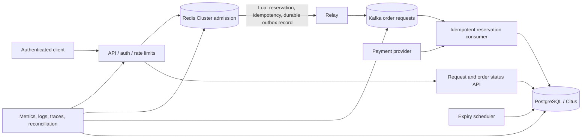
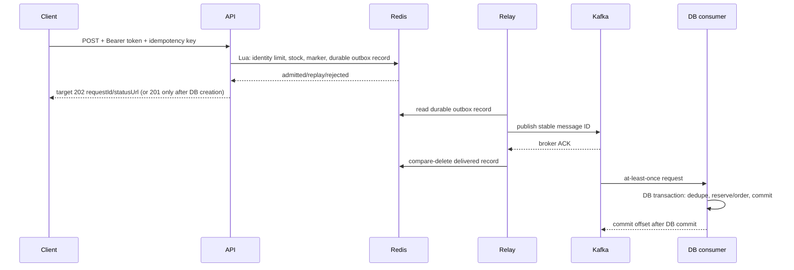
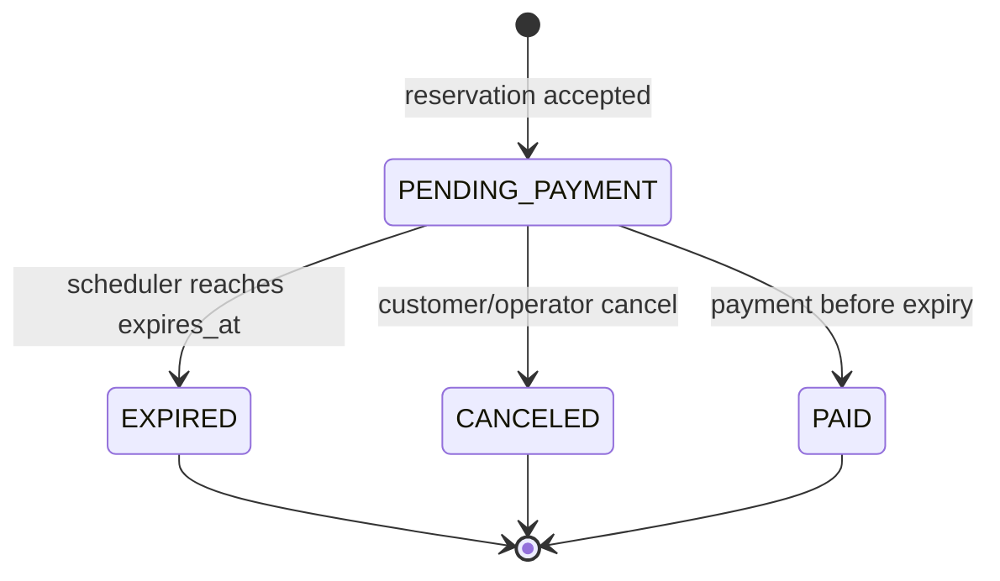

# Flash Sale System

Java 17/Spring Boot reference system for flash-sale admission and reservation. It is experimental: the current anonymous API and simulated payment endpoint are unsafe for production. This document distinguishes the **TARGET** production design from the **CURRENT** repository implementation.

## Scenario

A flash-sale event offers limited product inventory to a potentially much larger number of simultaneous customers. For example, 100 units may be offered to 100,000 customers at the same time. Customers browse inventory, submit an order, pay, and inspect order status. A user may buy only one unit of a product in an event. The system must prevent oversell; reservations expire after 15 minutes if payment is not completed, canceled, or otherwise released. Clients retry safely through idempotency keys.

**TARGET functional requirements**: inventory browsing; one unit per user/product/event; no oversell; 15-minute payment expiry with cancellation/release; order-status lookup; and retry-safe, idempotent submission.

**TARGET NFRs**: 100k requests/second, 1,000,000 concurrent users, typical product stock of 1,000, P99 under 200 ms, 99.99% availability, no oversell, horizontal scaling, and failure recovery.

Capacity is not inferred from an average alone:

```text
required admission RPS = (units released / sale window seconds) x peak factor x retry factor
API instances = ceil(required admission RPS / sustainable RPS per instance)
```

Size Redis, Kafka partitions/consumers, database connections, and durable backlog independently. A single extremely popular event remains a hot-key/single-event bottleneck: the current `{event:<id>}` Redis hash tag places all its fields on one Redis Cluster shard. Shard events/products deliberately, or accept that per-event serialization ceiling; adding API replicas cannot remove it.

**Measured current results, not production capacity claims**:

| Path | Measured result | Meaning |
| --- | --- | --- |
| Redis admission smoke test | **>=1,000 RPS** | Admission only; not end-to-end 100k RPS and not proof of Kafka publication or DB order creation. |

The k6 scripts use constant-arrival-rate traffic, unique idempotency keys, 60-second warm-up, five measured minutes, three runs, up to 1,000 VUs, and optional p95 < 200 ms/p99 < 500 ms thresholds. Environment, inventory state, topology, consumer lag, and host limits affect results.

## REST API Specs and Data Model

### TARGET contract

All identifiers are positive 64-bit integers and bodies are JSON.

| Route | Request | Designed response |
| --- | --- | --- |
| `POST /v1/orders/events/{eventId}/products/{productId}` | `Authorization: Bearer <token>` and nonblank `Idempotency-Key`; identity comes from the token | Supplied synchronous target: `201 {"orderId": "...", "status": "PENDING_PAYMENT"}`; same key and payload returns the original result. |
| `GET /v1/orders/{orderId}` | Bearer token; authorize owner/operator | `200` order, items, price snapshot, expiry, and status. |

For the Kafka asynchronous design, the recommended target response is instead `202 {"requestId": "...", "statusUrl": "/v1/order-requests/..."}`. `201` is appropriate only after durable order creation; returning it from Redis admission would overstate completion. Status lookup must expose pending, accepted, failed/retryable, and completed states without leaking another user's order.

### CURRENT repository endpoints and gaps

| Area | Current implementation | TARGET gap |
| --- | --- | --- |
| Admission | `POST /api/v1/flash_sale_event/{eventId}/product/{eventProductId}`, `UserId` + `Idempotency-Key`, returns `202 {"status":"PENDING"}` after Redis admission | No Bearer auth, order ID, or request-status API. |
| Reads | `GET /api/v1/flash_sale_event/{eventId}/orders` and `/order/{orderId}` | Different resource shape; no owner authorization. |
| Operations/payment | Preload: `POST /api/v1/operation/flash_sale_event/{eventId}`; simulated payment: `POST /api/v1/orders/{orderId}/payments` | Payment transfers no money and any reachable caller can mark an eligible order paid. |
| Delivery | Redis hash outbox plus optional in-process relay | Relay is disabled by default; no DLQ, result notification, automatic reconciliation, or full recovery workflow. |

Current validation maps bad input to `400`, absent resources to `404`, and conflicts to `409`; timeouts are ambiguous and must not trigger a blind inventory restore. Redis idempotency binds key, event, product, and user; a changed binding conflicts. Markers retain original keys with **no TTL**, grow indefinitely, and Redis admission currently neither verifies the user nor enforces a per-user limit.

### TARGET data model

| Table | Essential fields and constraints |
| --- | --- |
| `users` | `user_id` PK, unique `username`, credential/identity reference. |
| `products` | `product_id` PK, catalog data and nonnegative base inventory/price. |
| `flash_sale_events` | `event_id` PK, `start_at`, `end_at`, status (`UPCOMING`, `RUNNING`, `ENDED`, `CANCELED`). |
| `flash_sale_event_products` | event/product mapping; `allocated_quantity`, `reserved_quantity`, `sold_quantity`, `flash_price`, `per_user_limit`; enforce nonnegative values and `reserved_quantity + sold_quantity <= allocated_quantity`. |
| `orders` | `order_id`, user/event/event-product FKs, `idempotency_key`, status, `expires_at`, timestamps. Use `UNIQUE(user_id, event_product_id)` for one purchase per user/event-product, and separately `UNIQUE(user_id, idempotency_key)` for retry identity. If repeat purchases are a real business rule, replace the former with an explicit quantity/limit model. |
| `order_items` | one item/order, quantity `1`, immutable `unit_price` snapshot. |
| `order_payment` | payment ID, unique provider `transaction_id`, payment state and timestamps; at most one successful payment/order. |

Lifecycle is `PENDING_PAYMENT -> PAID`, `EXPIRED`, or `CANCELED`. Snapshot the flash price in the order item so later catalog changes cannot change an accepted price. `expires_at = reservation time + 15 minutes` governs payment eligibility.

The current consumer accepts schema-v2, single-item, quantity-one `ORDER_REQUESTED` messages. Its deterministic message ID is persisted as `orders.idempotency_key`; Kafka is acknowledged only after DB commit. Duplicate delivery is tolerated by uniqueness, but permanent failures can block a partition because there is no DLQ.

### TARGET transactional pseudocode

Run these in short PostgreSQL transactions. Retry serialization/deadlock failures with bounded backoff; on network timeout or unknown commit outcome, query by idempotency key rather than compensating blindly.

```sql
-- (a) Synchronous idempotent reservation and order creation
BEGIN;
SELECT order_id, status FROM orders
 WHERE user_id = :user_id AND idempotency_key = :key FOR UPDATE;
-- If found, verify event/product payload matches, COMMIT and return it.

UPDATE flash_sale_event_products
   SET reserved_quantity = reserved_quantity + 1
 WHERE event_product_id = :event_product_id
   AND event_id = :event_id
   AND EXISTS (
     SELECT 1 FROM flash_sale_events e
      WHERE e.event_id = :event_id AND e.status = 'RUNNING'
        AND now() BETWEEN e.start_at AND e.end_at
   )
   AND reserved_quantity + sold_quantity < allocated_quantity;
-- Require exactly one updated row, otherwise ROLLBACK as out-of-stock/not-running.

INSERT INTO orders (user_id, event_id, event_product_id, idempotency_key, status, expires_at)
VALUES (:user_id, :event_id, :event_product_id, :key, 'PENDING_PAYMENT', now() + interval '15 minutes')
RETURNING order_id;
INSERT INTO order_items (order_id, product_id, quantity, unit_price)
SELECT :order_id, product_id, 1, flash_price
  FROM flash_sale_event_products WHERE event_product_id = :event_product_id;
COMMIT;
```

```sql
-- (b) Expiry/cancellation: release a reservation, never allocated quantity
BEGIN;
UPDATE orders SET status = 'EXPIRED', updated_at = now()
 WHERE order_id = :order_id AND status = 'PENDING_PAYMENT' AND expires_at <= now()
RETURNING event_product_id;
-- Only when one order transitioned:
UPDATE flash_sale_event_products
   SET reserved_quantity = reserved_quantity - 1
 WHERE event_product_id = :event_product_id AND reserved_quantity > 0;
COMMIT;
```

```sql
-- (c) Payment: lock the pending order, atomically move reserved -> sold, record payment
BEGIN;
SELECT * FROM orders WHERE order_id = :order_id FOR UPDATE;
-- Require PENDING_PAYMENT and expires_at > now(); replay existing transaction id safely.
UPDATE flash_sale_event_products
   SET reserved_quantity = reserved_quantity - 1, sold_quantity = sold_quantity + 1
 WHERE event_product_id = :event_product_id AND reserved_quantity > 0;
INSERT INTO order_payment (order_id, payment_id, transaction_id, status)
VALUES (:order_id, :payment_id, :transaction_id, 'SUCCESS');
UPDATE orders SET status = 'PAID', updated_at = now() WHERE order_id = :order_id;
COMMIT;
```

For cancellation, use the same conditional `PENDING_PAYMENT` transition and release exactly one reservation. Payment-provider callbacks need their own idempotency/transaction uniqueness. Never increase `allocated_quantity` to release a reservation, and never “undo” an ambiguous transaction until authoritative state is reconciled.

## High-Level Components and Architecture

### TARGET architecture







The Lua script must authenticate-derived identity, enforce per-user limits, decrement only available stock, bind idempotency payload, and atomically add a durable handoff record. **CURRENT** code stores this outbox as fields in the event Redis hash and uses `idem:<key>`/`outbox:<requestId>`; its optional `RelayWorker` is in the API process, receives best-effort in-memory hints, then scans Redis masters (default fallback one second). Redis Streams with consumer groups is a stronger **TARGET option** for the durable handoff, but is not implemented here.

Redis-to-Kafka is not a distributed transaction. Redis async replication/failover can lose acknowledged admission/outbox writes; relay crashes, ACK timeouts, scans, and multiple relays can publish duplicates. Kafka is at-least-once: use idempotent producers, stable message IDs, consumer DB uniqueness in the same transaction, and commit offsets only after commit. Reconcile Redis markers/outbox, Kafka records/lag, and DB orders after failover; stop admission on uncertainty instead of automatic compensation. Redis scans are not snapshots and may omit/duplicate entries during resharding/failover.

Preload is a snapshot, not synchronization. The current preload refuses to overwrite an existing hash. During activation, migration, cleanup, or rebuild, stop writers, wait for in-flight work, back up and reconcile all three systems, then resume after verification. Expiry needs a durable scheduler/queue and idempotent conditional transitions; compensations must be explicit and auditable.

## Observability

**TARGET SLO signals**: admission accept/reject/replay rate; Redis command latency, errors, replication lag, persistence and eviction; relay backlog count/age/retries; Kafka publish failures and consumer lag; DB transaction rate, lock waits/deadlocks/serialization retries; expiry backlog/age; payment latency and failure rate; end-to-end request completion and P99 latency.

**CURRENT telemetry**: Actuator health is `/actuator/health`; under `dev`, Prometheus is at `http://localhost:8081/actuator/prometheus` (or the configured port). `monitoring/grafana/flashsale-dashboard.json` displays HTTP, JVM/CPU, datasource pool, and Tomcat metrics. Prometheus in Docker can scrape `host.docker.internal:<port>` with `metrics_path: /actuator/prometheus`.

Known gaps are material: no relay queue-depth/backlog/age/retry/scan-completeness metrics; no Redis command/replication metrics; no DB lock/wait metrics; no Kafka lag, expiry backlog, payment-latency, or reconciliation alerts. Health does not establish Redis-admission readiness. Secure management endpoints before production.

The benchmark scripts mutate inventory and orders; use only disposable, prepared data:

```bash
BASE_URL=http://localhost:8082 EVENT_ID=1 PRODUCT_ID=1 USER_ID=1 scripts/load-test-orders.sh
```

`load-test-orders.sh` measures Redis `202` admission. Do not run it against shared, development, or production state without cleanup and reconciliation.

## DevOps

Prerequisites are JDK 17+, Maven 3.6.3+, and explicitly provisioned dependencies. This repository does **not** automatically deploy/containerize PostgreSQL/Citus, Redis Cluster, Kafka, Prometheus, or Grafana.

```bash
mvn verify
SPRING_PROFILES_ACTIVE=dev java -jar flash-sale-api/target/flash-sale-api-0.0.1-SNAPSHOT.jar
mvn package
SPRING_PROFILES_ACTIVE=dev SPRING_KAFKA_BOOTSTRAP_SERVERS=localhost:9092 \
  java -jar order-consumer/target/order-consumer-0.0.1-SNAPSHOT.jar
mvn test -Dtest=InventoryPrimitivesTest -Dsurefire.failIfNoSpecifiedTests=false
```

`SPRING_PROFILES_ACTIVE` selects `dev`, `test`, or `prod`; API and consumer configuration is separate. Key API configuration includes `DB_JDBC_URL`, `DB_USERNAME`, `DB_PASSWORD`, `REDIS_CLUSTER_NODES`, `REDIS_HOST`, `REDIS_PORT`, `REDIS_USERNAME`, `REDIS_PASSWORD`, `INVENTORY_CACHE_ENABLED`, `RELAY_ENABLED`, `RELAY_TOPIC`, `RELAY_POLL_MS`, `RELAY_TIMEOUT_MS`, `RELAY_TRIGGER_QUEUE_CAPACITY`, and `SPRING_KAFKA_BOOTSTRAP_SERVERS`. Consumer defaults are topic `order-requests-v1` and group `reservation-consumer`, overridden by `RESERVATION_KAFKA_TOPIC`/`RESERVATION_KAFKA_GROUP_ID`; topic auto-creation is disabled. Store secrets in a secret manager or protected environment, never committed configuration.

Flyway is disabled by default and Hibernate does not own schema changes. Run reviewed migrations once as a controlled Job with a migration account before workload. The baseline is `flash-sale-api/src/main/resources/db/migration/V1__initial_flash_sale_schema.sql`; it has business DDL but no Citus distribution setup. **Never run V1 directly on an existing business DB; do not blindly baseline, repair, or clean.** Inspect schema, backups, and `flyway_schema_history`; validate matching PostgreSQL/Citus versions. Current Citus development gaps include `password_hash` and the order-item sequence.

```bash
# New dedicated local database only
mvn -pl flash-sale-api -am -DskipTests install
mvn -f flash-sale-api/pom.xml org.flywaydb:flyway-maven-plugin:11.7.2:migrate \
  -Dflyway.locations=filesystem:"$PWD"/flash-sale-api/src/main/resources/db/migration \
  -Dflyway.url=jdbc:postgresql://127.0.0.1:55432/flashsale \
  -Dflyway.user=flashsale -Dflyway.password=flashsale-local-dev
mvn -f flash-sale-api/pom.xml org.flywaydb:flyway-maven-plugin:11.7.2:validate \
  -Dflyway.locations=filesystem:"$PWD"/flash-sale-api/src/main/resources/db/migration \
  -Dflyway.url=jdbc:postgresql://127.0.0.1:55432/flashsale \
  -Dflyway.user=flashsale -Dflyway.password=flashsale-local-dev
```

`flash-sale-api/src/main/resources/db/dev/R__seed.sql` is only for a dedicated, quiescent development DB. It uses explicit IDs/sequences and does not repair inconsistent rows; its historic data, zero inventory placeholders, and absent password hashes may not support new orders.

Operate API and consumer as separate deployments; PostgreSQL/Citus, Redis Cluster, and Kafka as independently managed stateful topologies with durable volumes, replication/failover, backup, retention, and tested restore. Use authenticated ingress, NetworkPolicies, Secrets, resource limits, probes, and autoscaling on validated signals. Configure Kafka replication, `min.insync.replicas`, `acks=all`, idempotent producers, Redis persistence/no eviction, and enough Kafka partitions for consumers. Do not enable relay workers on multiple API replicas without accepting duplicate scans/publications and verifying consumer idempotency.

Deployment sequence: validate backups/topology; run and validate the controlled Flyway Job; create/verify Kafka topic; deploy consumer; deploy API with relay disabled; preload/reconcile Redis while quiescent; enable relay only after producer/monitoring verification; then admit traffic. For format changes, stop legacy and new writers, drain work, reconcile Redis/Kafka/DB, and do not assume markers, offsets, or legacy publishers are compatible.

Optional integration tests are destructive to declared disposable targets. `ReservationPostgresTest` needs a new empty DB and runs migrations/triggers. `RedisAdmissionIntegrationTest` needs a new empty local Redis selected by `reservation.redis.disposable.port`. Redis Cluster contract tests require an isolated cluster and may leave random keys after abnormal termination.
