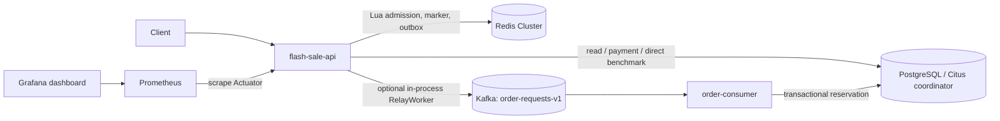
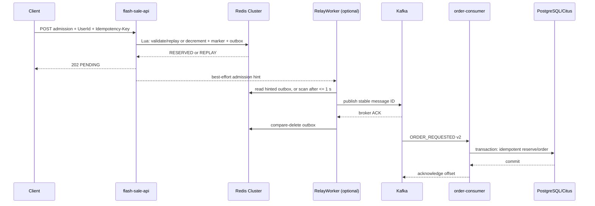
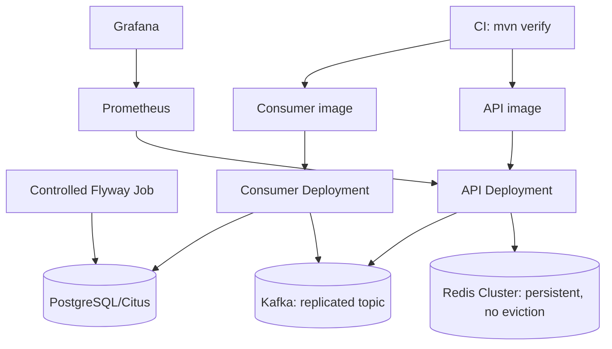

# Flash Sale System

A Java 17 / Spring Boot flash-sale reference system. `flash-sale-api` exposes order admission, reads, payment simulation, and an operator preload endpoint; `order-consumer` turns Kafka order requests into PostgreSQL/Citus reservations. Redis Cluster admission and its Redis outbox are experimental: treat this repository as a controlled demonstration, not a production-ready inventory system.

## Scenario

### Functional requirements

- Admit one unit of an event product for a user, with a client-provided idempotency key; a successful Redis admission returns `202 {"status":"PENDING"}`.
- Persist a single-item, quantity-one order through the consumer, support paginated order reads, and record a simulated successful payment.
- Preload an event's database inventory snapshot into Redis only while all writers for that event are stopped. The preload refuses to overwrite an existing hash.
- Publish admitted requests to Kafka through a Redis outbox when the relay is enabled; consume them idempotently into the database.

### Non-functional requirements

- Preserve idempotency across retries, tolerate Kafka duplicate delivery, and protect the database with transactional constraints.
- Keep the hot admission path independent of synchronous database order creation and Kafka acknowledgement.
- Make operational state observable through Actuator, Prometheus, Grafana, logs, and reconciliation procedures.
- Require explicit deployment, migration, topology, access-control, backup, and recovery decisions. The present anonymous API and simulated payment endpoint are **not suitable for production**.

### Capacity and benchmark interpretation

For a sale with `N` allocated units released over `W` seconds, the average admission rate is `N / W`. Size the peak rate as:

```text
required RPS = (N / W) x peak factor x retry factor
```

Then provision at least `ceil(required RPS / sustainable_RPS_per_instance)` API instances, while separately sizing Redis, Kafka partitions/consumers, database connections, and storage for the resulting backlog. For example, 100,000 units in 10 minutes with a 6x peak factor and 1.2x retry factor needs `100000 / 600 x 6 x 1.2 = 1,200 RPS` admission capacity before headroom.

Prior benchmark work reached these different conclusions:

| Path | Result | Completion semantic |
| --- | --- | --- |
| Direct database route | Roughly **75 RPS** was sustainable with zero dropped iterations. | `201` means an order was created; `200` is a database idempotency replay. |
| Redis cache-admission route | At least **1,000 RPS** in the high-RPS smoke test. | `202` means Redis admitted the request only. It does **not** mean Kafka publication or database order creation. |

The tests use k6 constant-arrival-rate traffic, unique idempotency keys, a 60-second warm-up, five measured minutes, three runs, up to 1,000 VUs, and default latency targets of p95 < 200 ms and p99 < 500 ms when thresholds are enabled. Results are environment-specific, not an SLO or a production capacity guarantee: inventory state, database locks, Redis/Kafka topology and durability, JVM/host limits, network, consumer lag, and test data all change the result. The direct route bypasses Redis, the outbox, and Kafka, so the two figures must not be compared as end-to-end throughput.

## REST API Specs and Data Model

All identifiers are positive 64-bit integers. Responses are JSON. Validation failures are `400`; absent resources are `404` where stated; mapped conflicts are `409`. Current security permits anonymous access, so do not expose these routes or management endpoints publicly.

| Route | Headers / body | Success | Important errors and behavior |
| --- | --- | --- | --- |
| `GET /api/v1/flash_sale_event/{eventId}/orders?page=0&size=20` | `page >= 0`, `1 <= size <= 100` | `200` paginated orders and items | Route retains `eventId`; results are paged by order ID. |
| `GET /api/v1/flash_sale_event/{eventId}/order/{orderId}` | None | `200` order and items | `404` if the order is absent. |
| `POST /api/v1/flash_sale_event/{eventId}/product/{eventProductId}` | `UserId`, `Idempotency-Key` (nonblank, <=128) | `202 {"status":"PENDING"}` for new Redis reservation or v3 replay | `409` conflict/out of stock/event not running; `404` product missing; `503` unavailable inventory or legacy replay requiring manual reconciliation. A timeout is ambiguous: do not blindly restore inventory. |
| `POST /api/v1/flash_sale_event/{eventId}/product/{eventProductId}/direct` | `UserId`, `Idempotency-Key` | `201` new database order; `200` replay, both `PENDING_PAYMENT` | Benchmark-only synchronous path; bypasses Redis, outbox, and Kafka. |
| `POST /api/v1/operation/flash_sale_event/{eventId}` | None | `201` Redis inventory hash created | `409` when already initialized; `400` invalid event data. Stop database and Redis inventory writers and reconcile before calling it. |
| `POST /api/v1/orders/{orderId}/payments` | JSON: positive `paymentId`, nonblank <=128 `transactionId`, optional <=30 `paymentMethod` | `201` simulated `SUCCESS` payment | `404` order absent; `409` ineligible/expired order, duplicate payment/transaction, or unavailable reservation. It moves reserved to sold atomically, but it transfers no money. **Anyone who can reach it can mark an eligible order paid.** |

Redis idempotency binds the key to event, event product, and user. A same binding replays without decrementing again; a different binding conflicts. Markers have **no TTL**, retain the original sensitive key, and grow indefinitely. The per-event hash uses the Redis Cluster hash tag `{event:<id>}`, so one event hash maps to one Redis shard; plan for that hot-key limit. Redis admission does not verify that the user exists or enforce per-user limits.

| Table | Purpose and key constraints |
| --- | --- |
| `users` | Positive `user_id` PK; unique nonblank `username`; optional nonblank `password_hash`. |
| `products` | Positive `product_id` PK; nonnegative inventory and price; timestamps are ordered. |
| `flash_sale_events` | Positive `event_id` PK; `end_at > start_at`; statuses `UPCOMING`, `RUNNING`, `ENDED`, `CANCELED`. |
| `flash_sale_event_products` | Event/product allocation, reservation, sale, flash price, and per-user limit. Unique event/product mappings and checks enforce `sold + reserved <= allocated`. |
| `orders` | Generated `order_id`; user/event/event-product foreign keys; global unique `idempotency_key`; statuses include `PENDING_PAYMENT` and `PAID`. |
| `order_items` | One item per order (`UNIQUE(order_id)`), quantity is exactly one, and price is snapshotted. |
| `order_payment` | Caller-provided `payment_id`, unique `transaction_id`, and partial unique index allowing at most one `SUCCESS` payment per order. |

The Kafka message ID is deterministic from event ID and idempotency key; the consumer uses its unprefixed UUID string as the database `orders.idempotency_key`. Other database writers must not reuse it. The consumer currently accepts only schema-v2 `ORDER_REQUESTED` messages containing one item with quantity one. It acknowledges Kafka only after its database transaction commits; database uniqueness handles duplicate delivery. Permanent errors retry indefinitely and can block a partition: there is no DLQ, compensation, result notification, or automatic reconciliation.

## High-Level Components and Architecture



`flash-sale-api` writes inventory, `idem:<key>`, and `outbox:<requestId>` atomically into the event hash through Lua. It does not preload Redis automatically. The optional `RelayWorker` lives in the API process and is **disabled by default** (`RELAY_ENABLED=false`). After admission, the request thread sends an immediate best-effort hint to a bounded in-memory queue. The worker publishes hinted outboxes first; when no hint arrives it scans Redis Cluster masters after the `RELAY_POLL_MS` fallback, defaulting to **1 second**. A successful Kafka acknowledgement compare-deletes the matching outbox value; failures and ambiguous acknowledgements retain it for retry.



This is at-least-once only under the assumption that acknowledged Redis state survives. It is not a Redis-Kafka transaction or exactly-once workflow. Crashes after Kafka acknowledgement, simultaneous relay-enabled API instances, scans, or timeouts can duplicate publication; a Redis loss, rollback, eviction, expiry, capacity exhaustion, or uncontrolled write can break admission, idempotency, or delivery. Stop admission and manually reconcile rather than assuming automatic recovery. Redis scans are not snapshots and may omit or duplicate fields during resharding/failover.

Inventory preload/activation is a snapshot, not synchronization with later database status or quantities. During migrations, upgrades, activation, cleanup, or rebuild: stop all writers, wait for in-flight work, back up and reconcile Redis, Kafka, and database state, then resume only after verification. Do not run legacy and v3 writers together, roll back directly, blindly redeliver historical markers, or overwrite a prefilled hash. Restrict Redis/log access because records include sensitive original keys and message envelopes.

## Observability

- Actuator health is at `/actuator/health`. With the `dev` profile, Prometheus is exposed at `http://localhost:8082/actuator/prometheus`; override `server.port` or use the actual runtime port as needed. The Grafana dashboard is `monitoring/grafana/flashsale-dashboard.json`.
- Prometheus can scrape a local host process from Docker using `host.docker.internal:<port>` and `metrics_path: /actuator/prometheus`.
- Track `http.server.requests` rate, errors, latency/histograms, JVM and CPU metrics, datasource pool activity, and Tomcat worker threads. The included dashboard visualizes these; percentile graphs are window estimates and can differ from k6 whole-run results.
- Critical gaps: the relay has no queue-depth, backlog, delivery-latency, retry, or scan-completeness metric; there are no Redis lock/command-latency metrics and no database lock/wait metrics. Add infrastructure exporters, Kafka consumer lag, Redis persistence/replication/eviction alerts, database lock monitoring, and reconciliation alerts before relying on this path.
- Secure management endpoints outside development. Health deliberately does not validate Redis admission readiness.

Run benchmark scripts against disposable, prepared data; they create orders or reservations and consume inventory. `load-test-orders.sh` is Redis admission (`202`), while the direct script defaults to `/direct` (`200,201`):

```bash
BASE_URL=http://localhost:8082 EVENT_ID=1 PRODUCT_ID=1 USER_ID=1 scripts/load-test-direct-orders.sh
BASE_URL=http://localhost:8082 EVENT_ID=1 PRODUCT_ID=1 USER_ID=1 scripts/load-test-orders.sh
```

Both require k6 or Docker. Do not aim either script at shared, development, or production state without an explicit cleanup and reconciliation plan; unique keys prevent replays and intentionally create business state.

## DevOps

Prerequisites: JDK 17+, Maven 3.6.3+, and explicitly provisioned dependencies as applicable. This repository does **not** automatically containerize or start PostgreSQL/Citus, Redis Cluster, Kafka, Prometheus, or Grafana.

```bash
# Build and test every Maven module
mvn verify

# API: shared config defaults to port 8081; dev points at local Citus by default
SPRING_PROFILES_ACTIVE=dev java -jar flash-sale-api/target/flash-sale-api-0.0.1-SNAPSHOT.jar

# Consumer: package first. The normal JAR is a library artifact; use the executable classifier JAR.
mvn package
SPRING_PROFILES_ACTIVE=dev SPRING_KAFKA_BOOTSTRAP_SERVERS=localhost:9092 \
  java -jar order-consumer/target/order-consumer-0.0.1-SNAPSHOT-exec.jar

# Focused tests
mvn test -Dtest=InventoryPrimitivesTest -Dsurefire.failIfNoSpecifiedTests=false
```

`SPRING_PROFILES_ACTIVE` selects `dev`, `test`, or `prod`; API and consumer have separate `application*.properties`, so configure each independently. Key API environment variables include `DB_JDBC_URL`, `DB_USERNAME`, `DB_PASSWORD`, `REDIS_CLUSTER_NODES`, `REDIS_HOST`, `REDIS_PORT`, `REDIS_USERNAME`, `REDIS_PASSWORD`, `INVENTORY_CACHE_ENABLED`, `RELAY_ENABLED`, `RELAY_TOPIC`, `RELAY_POLL_MS`, `RELAY_TIMEOUT_MS`, `RELAY_TRIGGER_QUEUE_CAPACITY`, and `SPRING_KAFKA_BOOTSTRAP_SERVERS`. Consumer topic/group defaults are `order-requests-v1` and `reservation-consumer`, overridden by `RESERVATION_KAFKA_TOPIC` and `RESERVATION_KAFKA_GROUP_ID`; topic auto-creation is disabled. Store all credentials in a secret manager or protected environment variables, never committed configuration.

Flyway is disabled by default and Hibernate never owns schema changes. Run migrations as a reviewed, single controlled Job before workloads, using a separate migration account. The baseline is `flash-sale-api/src/main/resources/db/migration/V1__capture_business_schema.sql`; it contains business DDL but no Citus distribution configuration. **Never run V1 directly on an existing business database. Do not blindly baseline, repair, or clean.** Inspect schema, backups, and `flyway_schema_history` first, validate on matching PostgreSQL/Citus versions, and keep old application compatibility in the rollout plan. Existing Citus development schema gaps include `password_hash` and the order-item sequence; coordinate a migration first.

```bash
# New, dedicated local database only; install modules, migrate, then validate.
mvn -pl flash-sale-api -am -DskipTests install
mvn -f flash-sale-api/pom.xml org.flywaydb:flyway-maven-plugin:11.7.2:migrate \
  -Dflyway.locations=filesystem:"$PWD"/flash-sale-api/src/main/resources/db/migration \
  -Dflyway.url=jdbc:postgresql://127.0.0.1:55432/flashsale \
  -Dflyway.user=flashsale -Dflyway.password=flashsale-local-dev
mvn -f flash-sale-api/pom.xml org.flywaydb:flyway-maven-plugin:11.7.2:validate \
  -Dflyway.locations=filesystem:"$PWD"/flash-sale-api/src/main/resources/db/migration \
  -Dflyway.url=jdbc:postgresql://127.0.0.1:55432/flashsale \
  -Dflyway.user=flashsale -Dflyway.password=flashsale-local-dev
```

The repeatable development seed at `flash-sale-api/src/main/resources/db/dev/R__seed.sql` is for a dedicated quiescent development database only. It has explicit IDs, adjusts sequences, and does not repair inconsistent existing rows; include its location on subsequent validation if it was applied. Its zero `total_inventory` placeholders, historic dates/orders, and no password hashes may not be suitable for new-order tests.



For Kubernetes, use separate API and consumer Deployments, a controlled migration Job, Secrets for credentials, NetworkPolicies, authenticated ingress, resource requests/limits, probes, and autoscaling based on validated signals. Operate PostgreSQL/Citus, Redis Cluster, and Kafka as independently managed stateful topologies with durable volumes, replication/failover, backups, retention, and tested restore procedures; verify Kafka replication factor, `min.insync.replicas`, `acks=all`, idempotent producers, Redis persistence, and no eviction. Increase consumer parallelism with Kafka partitions. Do not enable relay workers on multiple API replicas without accepting duplicate scans/publications and validating consumer idempotency.

Roll out in this order: validate backups and target topology; run/validate the migration Job; create and verify the new Kafka topic; deploy the consumer; deploy API with relay disabled; preload/reconcile Redis during quiescence; enable relay only after verifying producer configuration and monitoring; then admit traffic. For a format migration, stop legacy and new writers, wait for in-flight work, reconcile all systems, and never assume old offsets, markers, or direct-publishing writers are compatible.

Optional integration tests are destructive to their declared disposable targets. `ReservationPostgresTest` requires a new empty database and runs migrations/triggers. `RedisAdmissionIntegrationTest` requires a new empty local Redis selected with `reservation.redis.disposable.port`. Redis Cluster contract tests must use an isolated cluster and may leave random keys after abnormal termination:

```bash
mvn test -Dtest=ReservationPostgresTest -Dsurefire.failIfNoSpecifiedTests=false \
  -Dreservation.test.url=jdbc:postgresql://localhost:PORT/postgres \
  -Dreservation.test.user=postgres -Dreservation.test.password=disposable
mvn -pl flash-sale-api -am test \
  -Dtest=InventoryMarkerTest,InventoryMarkerPrefixTest \
  -Dsurefire.failIfNoSpecifiedTests=false -Dinventory.test.cluster.required=true \
  -Dinventory.test.cluster.nodes=host1:7001,host2:7002,host3:7003
```
